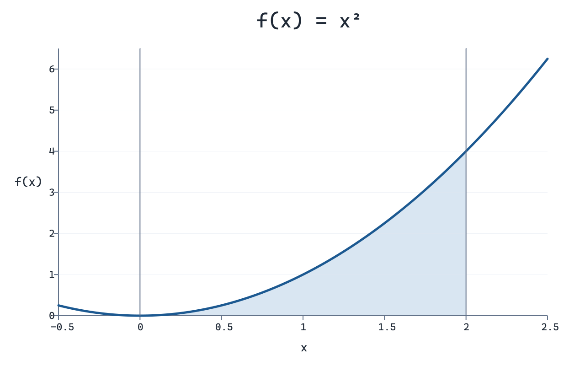

# Домашня робота до тем 9 та 10

Для запуску потрібен Python 3.10 або новіший зі стандартною бібліотекою. Виконайте команди з кореневої папки репозиторію.

```bash
python -X utf8 task_1.py
python -X utf8 task_2.py
```

## Завдання 1. Видача решти

Доступні номінали — `50, 25, 10, 5, 2, 1`. Обидві функції повертають словник із використаними номіналами та кількістю монет. Для суми `113` результат складається з п’яти монет — `{50: 2, 10: 1, 2: 1, 1: 1}`. Для суми `0` обидві функції повертають `{}`.

- `find_coins_greedy(amount)` перебирає номінали від найбільшого до найменшого. Для кожного номіналу `divmod` визначає, скільки таких монет можна видати, і яка сума лишається.
- `find_min_coins(amount)` знаходить мінімум для кожної суми від `0` до `amount`. Щоб отримати суму `s` і закінчити монетою `c`, потрібно взяти оптимальний розмін для `s - c` і додати одну монету. Функція порівнює ці варіанти, запам’ятовує вибраний номінал і відновлює розмін у зворотному порядку.

### Порівняння швидкодії

Нехай `S` — сума решти, а `k` — кількість номіналів. Жадібний алгоритм виконує щонайбільше `k` кроків, тому має складність `O(k)` за часом і використовує `O(1)` додаткової пам’яті без урахування словника результату. Для заданих шести номіналів кількість арифметичних операцій не зростає зі збільшенням суми. Динамічне програмування переглядає до `k` номіналів для кожної проміжної суми. Час становить `O(k × S)`, а пам’ять для таблиць — `O(S)`.

Час одного виклику виміряно за допомогою `timeit` у CPython 3.12.14 на Windows. Для кожної пари суми й алгоритму взято медіану семи серій і поділено її на кількість викликів у серії. Для жадібного алгоритму виконано по 20 000 викликів на серію, а для динамічного програмування — по 500, 20 і 3 відповідно. Суми мають однакову остачу від ділення на 50, щоб жадібний алгоритм проходив ті самі номінали в кожному прикладі.

| Сума | Жадібний алгоритм, мкс | Динамічне програмування, мкс | Монет в обох результатах |
|---:|---:|---:|---:|
| 113 | 0,479 | 34,950 | 5 |
| 10 113 | 0,483 | 3 637,345 | 205 |
| 100 113 | 0,480 | 39 515,633 | 2 005 |

У цьому порівнянні жадібний алгоритм швидший на всіх трьох сумах. При збільшенні суми його час лишався близьким до 0,48 мкс, тоді як час динамічного програмування зріс до 39,5 мс. Перевірка сум від 0 до 100 113 підтвердила мінімальну кількість монет для жадібного алгоритму в цьому діапазоні. Для інших номіналів вибір найбільшої монети може дати гірший результат. Наприклад, із номіналами `4, 3, 1` для суми `6` жадібний алгоритм вибере `4 + 1 + 1`, а динамічне програмування знайде `3 + 3`.

## Завдання 2. Інтеграл методом Монте-Карло

Обчислюємо площу під графіком `f(x) = x²` на відрізку `[0, 2]`.



`monte_carlo_integral` рівномірно генерує точки в прямокутнику `[0, 2] × [0, 4]`. Частку точок під кривою множимо на площу прямокутника, що дорівнює `8`. Точки обробляються по одній, тому час роботи становить `O(N)`, а додаткова пам’ять — `O(1)`, де `N` — кількість точок.

Аналітично отримуємо `∫₀² x² dx = [x³/3]₀² = 8/3 ≈ 2,66666667`. Для відтворюваності кожен запуск використовує початкове значення генератора `seed=42`.

| Кількість точок | Оцінка Монте-Карло | Абсолютна похибка |
|---:|---:|---:|
| 1 000 | 2,63200000 | 0,03466667 |
| 10 000 | 2,69280000 | 0,02613333 |
| 100 000 | 2,65968000 | 0,00698667 |
| 1 000 000 | 2,66114400 | 0,00552267 |

Для мільйона точок оцінка відрізняється від точного значення приблизно на 0,21%. У цьому запуску абсолютна похибка зменшилася зі збільшенням вибірки. Стандартна похибка методу спадає пропорційно до `1/√N`, хоча фактична похибка окремого запуску може коливатися.
